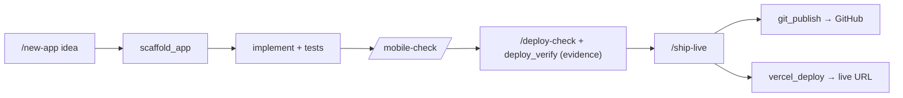
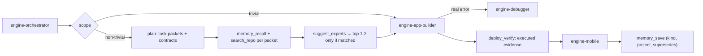
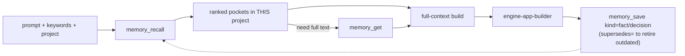
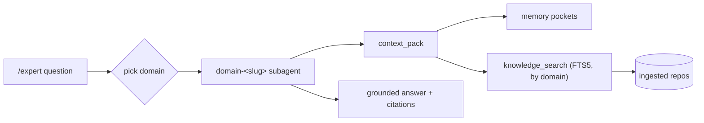
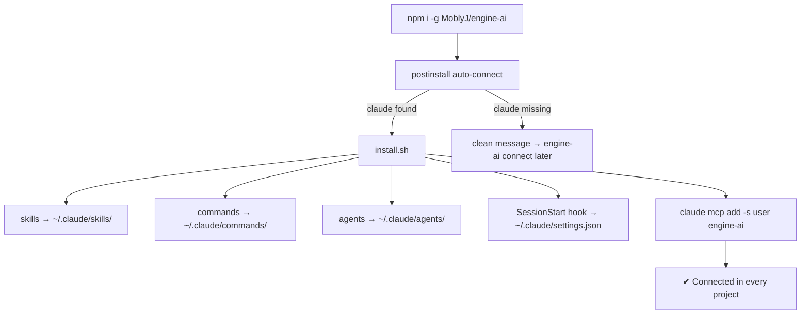

<div align="center">

# ◈ Engine-ai

### Turn your terminal **Claude Code** into a deployable-app factory — now with its own **multi-agent runtime**.
**Build → mobile-check → publish to GitHub → deploy to Vercel — from inside Claude Code.**
**v0.17: drop a `keys.csv` → 10 agents (each with its own OpenRouter key + model) plan, build, and verify — and a Codex CLI config is generated for you.**

[](#-install-one-command)
[](https://docs.claude.com/en/docs/claude-code)
[](https://modelcontextprotocol.io)
[](#)
[](#)
[](LICENSE)

</div>

---

## 🤔 What is it?

`engine-ai` is a **toolkit that plugs into the Claude Code you already run in the terminal**. One npm
command installs it and it **auto-connects** — adding slash commands, skills, and an **MCP server** of
tools your agent can call. You describe an app in plain English; Claude scaffolds it, tests it, checks
mobile responsiveness, and ships it to **GitHub + Vercel**.

Since **v0.17** it also ships a **provider-independent multi-agent runtime** (`engine_core`): drop a
`keys.csv` with one `key,model` line per agent and the **planner, frontend, backend, services,
database, test-author, reviewer, security-review, researcher, and documentation agents** each run
under their **own OpenRouter API key and model** — the planner decomposes your objective into a
validated task graph, workers build with real file/shell tools inside an isolated workspace, every
task is verified by executed commands (evidence manifests, not scores), and a **Codex CLI config**
(`~/.codex/config.toml`) is generated so `codex --profile engine_backend` runs on the same keys.
Keys live encrypted in a local vault — they are never committed, echoed, or put in prompts.

> No web dashboard. No cloud account. No heavy dependencies (pure Python stdlib). It lives inside
> Claude Code and works in **WSL / Linux / macOS**.

```
        you (in Claude Code)  ──"build me a landing page"──▶  Claude
                                                                │  calls engine-ai tools
                        ┌───────────────────────────────────────┴───────────────────────────┐
                        ▼                 ▼               ▼                ▼                   ▼
                   scaffold_app     responsive_audit   git_publish     vercel_deploy      deploy_readiness
                   (skeleton+       (mobile check)     (→ GitHub)      (→ live URL)       (ship checklist)
                    tests+Docker)
```

---

## 🚀 Install (one command)

```bash
npm install -g @okoboji/engine-ai
```

That's it — the installer **auto-detects Claude Code and connects itself**. Then **open a new Claude
Code session**. If `engine-ai: command not found` afterward, see the PATH note further down. Prefer
to try before installing? `npx @okoboji/engine-ai doctor` works too.

> **Published under `@okoboji/engine-ai`, not `engine-ai`** — the bare name `engine-ai` is already
> taken on the npm registry by an unrelated package. This is also a real **npm registry** package now
> (not a git-hosted install), which matters: an earlier version of this README documented a much more
> involved bootstrap command (directory-clearing, retry loops, `--ignore-scripts`) to work around a
> real, reproducible npm race specific to **git-dependency** installs on some filesystems (confirmed on
> WSL2, npm 11) — npm's own lifecycle-script runner would intermittently fail with `ENOENT` under
> several disguises (`spawn sh`, `spawn dash`, `uv_cwd`) while preparing a git-cloned package. Plain
> registry installs use npm's much more standard download-and-extract path and have not reproduced that
> race in testing, so the simple one-liner above is enough.

**Or from a git clone (same full feature set, if you want to build from source):**
```bash
git clone https://github.com/MoblyJ/engine-ai.git && cd engine-ai
npm install        # runs the auto-connect  (or:  ./install.sh)
```

> **All paths install every feature locally** — all MCP tools, skills, the `/agents` subagents, the
> commands, the hook, and the memory engine. Your memory pockets live in `~/.engine-ai/memory.db` and
> grow as you use it. Nothing is cloud-only; everything runs on your machine.

> **Claude Code not installed?** You'll get a clean message and engine-ai waits:
> ```
> ✗ Claude Code was not found on this system.
>   npm install -g @anthropic-ai/claude-code
>   engine-ai connect
> ```

Verify:
```bash
engine-ai doctor        # checks Claude Code + python3 + shows the MCP connection
claude mcp list        # → engine-ai … ✔ Connected
```

---

> **`engine-ai: command not found`?** The integration still works (skills/commands/tools were wired
> in) — only the optional helper CLI isn't on your PATH. npm's global bin dir just isn't on PATH on
> that machine. Fix:
> ```bash
> echo 'export PATH="$(npm prefix -g)/bin:$PATH"' >> ~/.bashrc && source ~/.bashrc
> # or run it directly:  npx @okoboji/engine-ai doctor
> ```

> **New tools / `/agents` / commands not showing after an update?** Claude Code loads them at session
> start. Run `engine-ai connect` (re-links everything + re-registers the MCP), then **open a new
> Claude Code session**. Verify with `claude mcp list` (→ `engine-ai … ✔ Connected`) and
> `engine-ai knowledge status`.

## 🔄 Updates & versioning

`engine-ai` is published to the npm registry as **`@okoboji/engine-ai`** (the bare name `engine-ai` is
taken there by an unrelated package, hence the scope). Every meaningful change is version-bumped,
tagged in git (`vX.Y.Z`), and published as a new registry version, so version numbers are real,
traceable, and installable both ways.

```bash
engine-ai update            # latest published version
engine-ai update 0.13.1     # pin to one exact published version
```

`npm update -g @okoboji/engine-ai` and `npm install -g @okoboji/engine-ai@latest` also work correctly
now — this is a real, legitimately-owned registry package, not a squatted name. `engine-ai update` is
still the recommended path since it does a full clean uninstall + reinstall, which is slightly more
reliable than an in-place update on some filesystems.

Check what you have installed: `engine-ai doctor` prints the running version. Browse all releases
and their notes at https://github.com/MoblyJ/engine-ai/releases, `git tag -l`, or
https://www.npmjs.com/package/@okoboji/engine-ai.

> **Releasing (maintainers):** `npm run release -- <patch|minor|major> "<description>"` bumps
> `package.json`, commits as `vX.Y.Z: <description>`, tags it, pushes both, and best-effort creates
> a GitHub Release. Requires a clean tree on `main`, in sync with `origin/main`. It does **not**
> publish to the npm registry automatically — that still requires `npm publish --access public` with
> either a live OTP (`--otp=<code>`) or an authenticated token, since publishing isn't automated with
> stored credentials on this machine by design.

## 🎮 Use it (inside Claude Code)

| Command | What it does |
|---|---|
| `/new-app <idea>` | Build a **deployable** app in a **hard-isolated git worktree** (own branch + folder) — the orchestrator runs the full A2A loop with memory |
| `/resume-app` | List past app sessions (2-line summary each) and **reopen** one — its worktree folder + memory context restored |
| `/mobile-check [path]` | Audit & fix **mobile responsiveness** |
| `/deploy-check [path]` | Score deployability and fix the gaps |
| `/ground <task>` | Index the repo and work grounded in its real code (RAG) |
| `/ship-live` | **Session-aware** ship: publish the app's worktree/branch to **GitHub** + **Vercel**, verify the URL, record it back to the session |
| `/expert <question>` | Ask one of **30 domain experts** (frontend, system-design, ML, LLM, security…) — grounded in **ingested engineering knowledge** + memory |
| `/knowledge [query]` | **Browse & search** the ingested knowledge store — domains, sources, full-text search with citations |
| `/research <question>` | **Live web search** for current, real-time info the offline knowledge store can't have — cites sources, saves findings to memory |

Or just talk to it: *"build a responsive coffee-shop landing page, then ship it live."*

**Outside Claude Code, the agents work on their own** (their keys, their models):

```bash
echo "sk-or-v1-…,nvidia/nemotron-3.5-super-vl:free"   # one line per agent → ~/.engine-ai/keys.csv
engine-ai runtime keys                                 # auto-detected, encrypted, permanent
engine-ai runtime build "a small todo API with tests"  # planner → workers → verifier → evidence
```



---

## 🧰 What you get

<table>
<tr><td valign="top">

**Slash commands** (10)
`/new-app` · `/resume-app` · `/expert`
`/knowledge` · `/mobile-check`
`/deploy-check` · `/ground` · `/ship-live`
`/research` · `/debug`

**Agents** — in `/agents` (38)
`engine-orchestrator` + 7 engine agents
`engine-{app-builder,mobile,deployer,`
`grounder,memory,researcher,debugger}` ·
**30 `domain-*` experts** (frontend,
system-design, ml, llm, security, …)

**Skills** — auto-triggered (7)
`deployable-app` · `mobile-responsive`
`publish-and-deploy` · `expert-answer`
`web-research` · `debugging`
`code-architecture`

</td><td valign="top">

**MCP tools** (40)

🏗️ *Build / ship* — `scaffold_app` ·
`deploy_readiness` · `deploy_verify` ·
`responsive_audit` · `git_publish` · `vercel_deploy`

🔎 *Repo / skills* — `index_repo` ·
`search_repo` · `list_skills` · `get_skill` ·
`import_repo_skills`

🔐 *Secrets* — `set_secret` · `list_secrets`

🧠 *Memory pockets* — `memory_save` ·
`memory_recall` · `memory_context` · `memory_get` ·
`memory_list` · `memory_forget`

📦 *App sessions (worktrees)* — `app_create` ·
`app_update` · `app_list` · `app_resume` ·
`app_find`

🎓 *Knowledge swarm* — `knowledge_ingest` ·
`knowledge_search` · `knowledge_domains` ·
`context_pack` · `suggest_experts`

🌐 *Web search* — `web_search` ·
`web_search_status`

🪲 *StackOverflow* — `so_search` ·
`so_debug`

⚙️ *Engine agent builds* — `engine_info` ·
`engine_build_start` · `engine_build_status` ·
`engine_build_resume`

</td></tr>
</table>

---

## 🧑‍🚀 Agents — 38 subagents (in Claude Code `/agents`)

engine-ai installs **38 subagents** into `~/.claude/agents/`: **8 engine agents** (below) that run the
build/ship loop, and **30 `domain-*` experts** (see [Knowledge swarm](#-knowledge-swarm--30-domain-experts-grounded-by-retrieval)).
They show up in Claude Code's `/agents` menu and are invoked either directly or by the orchestrator as
an **agent-to-agent (A2A) loop**. Each has its own context and its own tool set (so it can only do its job).

| Agent | What it does | When it runs | Its tools |
|---|---|---|---|
| 🧭 **engine-orchestrator** | The lead. For any "build/ship an app" request it assembles **full context** and delegates the others in order: recall → ground → build → mobile → ship → save. | `/new-app` or any build request | `Task`, R/W/E, Bash, `memory_recall`/`memory_save`, `index_repo`/`search_repo`, `list_skills`/`get_skill` |
| 🏗️ **engine-app-builder** | Scaffolds, implements, tests, and gates the app to **verified deployability** (`deploy_verify` evidence, not just a readiness score). | mid-loop, or "build an app" | `scaffold_app`, `deploy_readiness`, `deploy_verify`, `search_repo`, `set_secret`, `memory_recall` + R/W/E, Bash |
| 📱 **engine-mobile** | Audits & fixes mobile responsiveness; recalls/saves mobile decisions to the session. | mid-loop, or `/mobile-check` | `responsive_audit`, `memory_context`/`recall`/`save`, `app_find`/`app_update` + R/W/E, Bash |
| 🚀 **engine-deployer** | Publishes to **GitHub** + deploys to **Vercel**; asks for the repo name; never bypasses auth. | mid-loop, or `/ship-live` | `git_publish`, `vercel_deploy`, `deploy_readiness` + Read, Bash |
| 🔎 **engine-grounder** | Indexes the repo and returns the relevant code/docs (RAG); saves the grounding to memory. | before edits, or `/ground` | `index_repo`, `search_repo`, `memory_context`/`recall`/`save`, `app_find` + Read, Bash |
| 🧠 **engine-memory** | Recalls & saves keyword-tagged **memory pockets** so apps evolve across prompts. | any time context matters | `memory_recall`/`context`/`save`/`list`/`forget` |
| 🌐 **engine-researcher** | Two jobs: (1) live web search for current info the offline knowledge store can't have; (2) precedent-grounded OOP class-diagram design before non-trivial builds. | time-sensitive Qs, `/research`, or pre-build design | `web_search`, `web_search_status`, `so_search`, `memory_context`/`recall`/`save` + Read |
| 🪲 **engine-debugger** | Fixes a real error/exception by grounding the fix in StackOverflow precedent (cited accepted/top answers), then verifies it. | on a real error, or `/debug` | `so_search`, `so_debug`, `search_repo`, `memory_context`/`recall`/`save` + Read, Edit, Bash |

**The orchestrator's loop** (v0.17): scope the request first, plan a small dependency graph of
task packets, gather context **per packet** (conditional experts/research — never the whole swarm),
escalate to the debugger only on real error evidence, verify with executed commands, and save typed
memory (decisions/facts, explicit supersede):


## 📓 Skills — 7 auto-triggered workflows

Skills are methodologies Claude adopts **automatically** from your wording (no command needed). Each
has memory bookends (recall first, save last) so work evolves.

| Skill | What it enforces | Auto-fires when you… |
|---|---|---|
| **deployable-app** | recall + domain knowledge → scaffold → implement → **test** → readiness + `deploy_verify` evidence → mobile → secrets → publish → deploy → save. "Done" only when the project's own test command exits 0 at the current commit and the checklist is covered. | ask to build/create an app, API, or site |
| **mobile-responsive** | recall → audit → fix (viewport, `@media` 640/768/1024, fluid units, tap targets ≥44px, responsive images) → verify at 390/768px → save | build/review any UI, or say mobile/responsive/phone |
| **publish-and-deploy** | check tests + readiness → **GitHub** (asks name) → **Vercel** → verify the live URL → save | say push, deploy, go live, or ship |
| **expert-answer** | `suggest_experts` → `context_pack` / domain expert → **cited** recommendation with tradeoffs → save | ask "how should I design/architect/scale/secure…", best practices, or X vs Y |
| **web-research** | `web_search_status` (optional) → `web_search` → synthesize, **citing source URLs** → save | ask about current versions, pricing, recent changes, news — anything time-sensitive |
| **debugging** | ground → `so_debug`(error text) → prefer accepted/top answer → apply + adapt fix → **re-run and verify** → save | there's a real error, exception, traceback, or failing test to fix |
| **code-architecture** | `web_search`/`so_search` precedent → design a **Mermaid classDiagram** (single responsibility, reuse, DI, no duplication) → implement → save | building a new module/feature with more than one responsibility |

## ⌨️ Commands — 10 slash commands

Every command shares **one loop**: locate the app session (`app_find`) → **recall** memory → do the
work → **save** memory + update the session. So an app accumulates its branch + folder + memory +
status across all of them.

| Command | Flow |
|---|---|
| `/new-app <idea>` | `app_create` (**git worktree** — own branch + folder) → orchestrator **A2A** build → `memory_save` + `app_update` |
| `/resume-app` | `app_list` (2-line summaries incl. 📱/🚀 status) → pick → `app_resume` (folder + branch + memory restored) |
| `/ground <task>` | `app_find` + `memory_context` → `index_repo` + `search_repo` → `memory_save` (`grounded_files`) |
| `/mobile-check [path]` | `app_find` + `memory_context` → `responsive_audit` → fix → `memory_save` + `app_update` (📱) |
| `/deploy-check [path]` | `app_find` + `memory_context` → `deploy_readiness` → fix to 100 → `memory_save` + `app_update` (🚀) |
| `/ship-live` | `app_find` → gate → `git_publish` + `vercel_deploy` → verify → `memory_save` + `app_update` (URLs) |
| `/expert <q>` | pick domain(s) → delegate to `domain-<slug>` expert(s) → `context_pack` + `knowledge_search` → cited answer |
| `/knowledge [q]` | `knowledge_domains` (browse) or `knowledge_search` (find) → cited hits; open source files under `~/.engine-ai/sources/` |
| `/research <q>` | `memory_context` → `web_search` → synthesize, cited by source URL → `memory_save` |
| `/debug <error>` | `memory_context` → `so_debug` → apply + adapt fix → **verify it passes** → `memory_save` |

## 🧰 MCP tools — 40 (the agent calls these; you ask in English)

| Group | Tool | Purpose |
|---|---|---|
| ⚙️ Engine builds | `engine_info` | which source tree / commit / engine home the **running server** loaded, whether the bubblewrap shell sandbox is available, provider mode — confirms the client talks to the code you expect |
| | `engine_build_start` | start the engine's **own multi-agent build** in the background (planner → per-profile workers → verification) in a fresh workspace; returns a `run_id` at once |
| | `engine_build_status` | live state (`running/complete/failed/blocked/crashed`), per-task states, recent events and — when finished — the report (task ids, dependencies, profiles, models, artifacts, verification, attempts, engine usage); `wait_s` ≤ 45 |
| | `engine_build_resume` | re-run a workspace's **stored plan** (no re-planning): still-valid finished tasks are kept, failed/blocked/not-run/invalidated ones run again |
| 🏗️ Build/ship | `scaffold_app` | write a deployable skeleton (node-api / python-api / static): node/python get a server + `/healthz` + tests, static gets `index.html` + a test; all get Dockerfile + CI + `.env.example`. Refuses to overwrite existing files unless `replace=true` (originals kept as `*.engine-ai.bak`); `dry_run=true` previews |
| | `deploy_readiness` | deployability **inventory** + parsed **evidence** (declared scripts, test framework, CI, exact commit) + what's missing |
| | `deploy_verify` | **execute** the project's own test command and return an evidence manifest (commands, exit codes, durations) bound to the commit |
| | `responsive_audit` | static mobile-responsiveness score + findings (static hints — not a browser-verified journey) |
| | `git_publish` | create a GitHub repo and push; **idempotent** — reuses an existing `origin` instead of re-creating; worktree-aware |
| | `vercel_deploy` | deploy and return the live URL (returns `needs_auth` if not logged in) |
| 🔎 Repo/skills | `index_repo` / `search_repo` | build + query a repo-aware index — **incremental** (only changed files re-embedded) and hits carry **line spans** |
| | `list_skills` / `get_skill` | browse the workflow library |
| | `import_repo_skills` | ingest more `SKILL.md` skills from any repo |
| 🔐 Secrets | `set_secret` / `list_secrets` | encrypted-at-rest secrets vault (**AES-256-GCM**; lists names only, never values) |
| 🧠 Memory | `memory_save` | save a keyword-tagged pocket — **immutable and project-scoped**; pass `supersedes=<id>` to explicitly retire an outdated one; `kind`: fact/decision/idea/error/note |
| | `memory_recall` / `memory_context` | hybrid keyword+embedding recall within one project; retired pockets excluded; bounded previews |
| | `memory_get` | fetch a pocket's full text + provenance + supersede chain |
| | `memory_list` / `memory_forget` | list / delete pockets |
| 📦 App sessions | `app_create` | start an app in its own **git worktree** (branch + folder), recording the actual branch + base SHA |
| | `app_list` / `app_resume` | list sessions (2-line summaries) / reopen one with folder + memory + drift check |
| | `app_update` | save a session's 2-line summary + keywords |
| | `app_find` | which app session a working dir belongs to (for session-aware commands) |
| 🔑 OpenRouter | `openrouter_setup` | check every agent's API-key + model assignment; when anything is missing it returns **ask_user instructions** — Claude prompts you for `key,model` lines (or a CSV path) and imports them |
| | `openrouter_import` | import pasted `key,model` / `profile,key,model` lines (or a CSV **file path**) — keys stored **permanently** in the AES-256-GCM vault, models saved per profile |
| | `codex_setup` | generate **Codex CLI** config: one OpenRouter `[model_providers.engine_<p>]` per agent in `~/.codex/config.toml` + one `~/.codex/engine_<p>.config.toml` profile file each (`codex --profile engine_<p>`); keys stay in the vault (`eval "$(engine-ai runtime codex-env)"`), plaintext env file only with `write_env: true`; never touches `auth.json` |
| 🎓 Knowledge | `knowledge_ingest` | clone/ingest a repo into the domain-tagged FTS5 store (records the source commit; `refresh=true` to update) |
| | `knowledge_search` | BM25 search the ingested knowledge, optionally by domain |
| | `knowledge_domains` | list ingested domains + chunk/repo counts + source freshness |
| | `context_pack` | prior memory + retrieved knowledge compiled **within a token budget** (default ~6k tokens) |
| | `suggest_experts` | deterministic router: request → ranked `domain-<slug>` experts (max 5, word-boundary matching) + task profile + worker-profile mapping |

---

## 🧠 Memory pockets — apps that *evolve* across prompts

Inspired by **[HelixDB](https://github.com/helixdb/helix-db)** (graph + vector AI memory), reduced to a
tiny Python/SQLite store. Each **pocket** is an **immutable record** tagged with **keywords**, a
**kind** (`fact` / `decision` / `idea` / `error` / `note`), a **project**, and optional provenance.
Recall is hybrid (keyword overlap **+** embedding similarity) within one project — facts from one
project never leak into another.

**Nothing merges implicitly.** Records never get merged just because their keywords look similar;
when a decision changes, save the new one with `supersedes=<old id>` — the old pocket is retired from
recall but stays retrievable (with its full chain) via `memory_get`, so evidence is never destroyed.
Recall returns bounded previews; `memory_get` fetches full text on demand.



The **engine-orchestrator** runs this as an **agent-to-agent (A2A) loop**: recall memory → ground in
the repo → plan → build → mobile → ship → save memory. Each agent's output feeds the next, so the
final prompt is assembled in **full context**. Stored at `~/.engine-ai/memory.db`.

---

## ⚙️ engine_core — the standalone runtime (new in v0.16)

Claude Code owns the model/tool loop for the tools above. **`engine_core/`** is the extraction of
that into a provider-independent runtime (pure stdlib), so tasks can also run without Claude Code:

| Layer | What it owns |
|---|---|
| `providers/` | OpenRouter/local adapters, fetched+validated model catalog with **pinned** model IDs, per-account-group rate limiting with atomic reservation, typed errors (auth/quota/rate-limit/network), Retry-After honored |
| `runtime/` | TaskSpec dependency graphs (cycle/unknown-dep validation), durable state with **leases + fencing tokens**, scheduler bounded by `max_active_workers`, worker loop with turn/call budgets and checkpoints |
| `context/` | Budgeted **context packets** (objective, acceptance, permitted paths, base SHA, code spans, verified decisions, latest failure), exact-path/symbol → search → neighbor retrieval, symbol spans with file hashes |
| `memory/` | Project-scoped memory facade — separate `fact`/`decision`/`idea`/`error` kinds; a model claim is not verified evidence |
| `workspaces/` | Git task worktrees (checked subprocess results, actual-branch validation) + the **single serialized integrator** (file-locked; conflicts raise explicit resolution tasks; failed verification reverts the merge) |
| `tools/` | Registry + **policy-enforcing executor** (a `read_only` profile physically cannot call a writing tool) + effect journal (no repeated writes after transport failures) |
| `verification/` | Command runner against exact revisions + **evidence manifests** (tested SHA, commands, exit codes, artifacts by content hash) |
| `telemetry/` | Usage/cost journal (tokens incl. cached/reasoning, calls, latency, cost) + append-only event log |

Routing follows the [upgrade review](upgrade.md): **ten profiles, not ten accounts** — every agent
gets its own profile with its own credential reference and model, but keys give attribution/
revocation, not extra quota; free-only by default; quota exhaustion **pauses** (never rotates
credentials); auth failures stop, they don't retry. Start with 2 active workers.

**Assign a different API key + model to each agent:**

The easiest path is inside Claude Code — just ask (e.g. *"set up openrouter keys"*). The flow:

1. `openrouter_setup` checks all 10 profiles and returns **ask_user instructions** when a key or
   model is missing → Claude prompts you.
2. You paste lines — `key,model` per line (auto-assigned to the missing profiles in order), or
   explicit `profile,key,model` — or point at a CSV file. A header row and `#` comments are fine.
3. `openrouter_import` stores each key in the **encrypted vault** and the model per profile —
   **permanent** across restarts, never echoed back (masked `set (…abcd)`).
4. `codex_setup` generates **Codex CLI** config from whatever is configured.

```bash
engine-ai runtime profiles list      # all 10 profiles: key status (masked), model, agents
engine-ai runtime profiles agents    # engine agents + domain experts → profile mapping
engine-ai runtime profiles set frontend --credential-ref vault:OPENROUTER_FRONTEND_KEY --model <id>
engine-ai runtime profiles show frontend
# store the key itself encrypted (never in a config file): set_secret, name OPENROUTER_FRONTEND_KEY
```

Keys live in the environment (`env:VAR`) or the AES-256-GCM vault (`vault:NAME` via `set_secret`);
profiles store **references only**. Agents share work through the project-scoped memory store,
bounded context packets, and the serialized integrator — each worker runs its packet under its
own key/model and hands off structured outcomes.

**Codex CLI** (`codex`, tested 0.163.0): `codex_setup` writes a marked block into
`~/.codex/config.toml` with one `[model_providers.engine_<profile>]` per configured agent
(OpenRouter base URL, `wire_api = "responses"`, its own `env_key`), one
`~/.codex/engine_<profile>.config.toml` profile file per agent. The keys themselves stay in the
encrypted vault: `eval "$(engine-ai runtime codex-env)"` exports the `OPENROUTER_<PROFILE>_KEY`
variables into the current shell without writing them anywhere, then `codex --profile
engine_backend`. (`codex_setup({write_env: true})` additionally writes a chmod-600 plaintext
`~/.codex/engine-ai-env.sh`, opt-in only.) Verified with Codex 0.163: each `--profile
engine_<p>` selects that agent's own model, provider and key variable. **Codex does not reject an
unknown profile name** — a typo such as `--profile engine_bakend` silently runs the *default*
(`active`) profile, so check the `model:` / `provider:` lines Codex prints at startup. Codex 0.163 refuses to start with `wire_api = "chat"` and
rejects legacy `[profiles.*]` tables when `--profile` is used, so neither is written. Your other
config is preserved (backup kept, block rewritten idempotently) and `auth.json` is **never
touched**. That makes the engine's OpenRouter keys available as Codex *model providers*; to let
Codex *call engine-ai tools*, register the MCP server too (see
[Agent builds through MCP](#-agent-builds-through-mcp--tested-setup)).

### keys.csv → 10 agents → shipped work

Drop a `keys.csv` anywhere conventional (`~/.engine-ai/keys.csv`, `./keys.csv`, or
`$ENGINE_AI_KEYS_CSV`) with one `key,model` line per agent profile (a header row, `#`
comments, BOM/CRLF from Excel are all tolerated). It is **auto-detected**: `openrouter_setup`
reports it (with a warning if it sits inside a git repo — it is git-ignored by this toolkit and
must never be committed) and Claude asks you to confirm the import. On a **fresh setup**, a
keys.csv at `~/.engine-ai/keys.csv` (or `$ENGINE_AI_KEYS_CSV`) is **auto-assigned the moment a
session starts** — every agent ready with no prompt; partial/hand-made setups are never
overwritten, and files found only in the current directory always ask first. Then the agents
take over — ideation, planning, code, and verification all come from the agents under their own
keys:

```bash
engine-ai runtime keys               # detect + import keys.csv → the 10 profiles
engine-ai runtime build "a small todo API with tests" --project todo   # plan → build → verify
engine-ai runtime build-status --workspace ~/.engine-ai/builds/<slug>  # live state + report
engine-ai runtime resume ~/.engine-ai/builds/<slug>                    # retry from the stored plan
eval "$(engine-ai runtime codex-env)"   # export the vault keys into this shell (for Codex) — nothing on disk
```

Relative paths (`--workspace .`, `--path .`, `./keys.csv`) resolve against the directory you run
the command in. `runtime run`, `build` and `resume` also accept
`ENGINE_AI_PROVIDER=scripted:<script.json>` for an offline dry run with no keys and no network.

The **planner** agent decomposes your objective into a validated task graph (contract first, one
owner per file); each **worker** runs its packet under its own profile's key + model with real
build tools; dependents receive their dependencies' outcomes **and artifact contents**; the
project's memory (that project only) feeds the planner and every worker; a task counts only when
its required artifacts exist on disk and its verification commands pass in the sandbox. Exit
codes: `0` every planned task done, `1` failed, `2` blocked (quota/auth — resume later). See
[Agent builds through MCP](#-agent-builds-through-mcp--tested-setup) for the full workflow.

```bash
engine-ai runtime plan --graph tasks.json    # validate a task dependency graph
engine-ai runtime models refresh             # fetch the live model catalog (network)
engine-ai runtime models pin backend <model-id>   # pin an evaluated model ID
engine-ai runtime run --graph tasks.json --agent engine-app-builder   # run under that agent's key+model
engine-ai runtime status                     # standalone `run` queue + usage (builds: use build-status)
engine-ai runtime verify --path . -- pytest -q          # or one quoted string: "npm test && npm run lint"
```

---

## 🧪 Agent builds through MCP — tested setup

Everything in this section was run on **WSL2 (Ubuntu 26.04), Python 3.14.4, Node 22.23.4,
Claude Code 2.1.319, Codex CLI 0.163.0, bubblewrap 0.11.1**. Plain Linux uses the same
commands; macOS was not tested. `$ENGINE_AI_DIR` below means your engine-ai checkout (or the
npm install's package directory).

### Two different bills: the host assistant vs. the engine's agents

- **The host assistant** is Claude Code or Codex. It runs on *its* account and model (your
  Claude plan, or whatever provider Codex is configured with). Its reasoning and the MCP
  tool calls it makes are billed there.
- **The engine's agents** (planner, frontend, test-author, reviewer, …) run inside
  `engine_core` on the **OpenRouter profiles** you configured — one key + model per profile,
  free-only by default.

Connecting the MCP server does **not** move the host assistant onto engine keys, and it does
**not** hand the host's conversation to the engine: `engine_build_start` passes the objective
you (or the host) put in it; the agents see that objective, the plan, their dependencies'
outputs and *this project's* memory — nothing else. Build reports count **engine** usage only
(`usage.planner`, `usage.workers`); the host's usage is shown by the host (e.g. `claude -p
--output-format json` → `total_cost_usd`).

### Prerequisites (Linux / WSL)

```bash
python3 --version        # 3.11+ required (stdlib only, uses tomllib); 3.14.4 tested
node --version           # for the example's acceptance tests; 22.23.4 tested
bwrap --version          # bubblewrap: REQUIRED for agent shell + verification commands
sudo apt install bubblewrap   # Debian/Ubuntu, if missing
```

Without bubblewrap the engine still builds with `write_file`/`read_file`, but it **refuses**
every model-chosen shell command (worker `run_command` and planner verification commands)
instead of running it unconfined — tasks that need verification then fail with a clear reason.

### Claude Code: register, reconnect, smoke-test

```bash
# a) installer (user scope — every project): links skills/commands/agents + registers the MCP
cd "$ENGINE_AI_DIR" && ./install.sh          # or: engine-ai connect
claude mcp list                              # → engine-ai: python3 …/mcp/forge_mcp.py - ✔ Connected

# b) project scope, for working ON engine-ai: the repo ships .mcp.json
#    ("args": ["${CLAUDE_PROJECT_DIR:-.}/mcp/forge_mcp.py"]) — Claude Code asks once to approve it
```

Claude Code loads MCP servers at session start: after an update, reconnect the server from
`/mcp` in the session, or start a new session (`claude -p` runs always start fresh servers).
Per Claude Code's scope precedence (local → project → user), a **project** `.mcp.json` server
named `engine-ai` is used instead of a user-scope one with the same name. To prove which code a session talks to, ask for
`engine_info` — its `source_dir` is the directory the running server was loaded from.

Smoke test (non-interactive, *only* this checkout's server, real model-issued tool calls):

```bash
cd "$ENGINE_AI_DIR"
claude -p "Call engine_info and report source_dir and git_commit." \
  --mcp-config .mcp.json --strict-mcp-config \
  --allowedTools "mcp__engine-ai__engine_info" --output-format stream-json --verbose
# stream-json shows system/init (mcp_servers: engine-ai connected, tools discovered),
# the tool_use, and the tool_result with source_dir
```

### Codex: register and smoke-test

```bash
codex mcp add engine-ai -- python3 "$ENGINE_AI_DIR/mcp/forge_mcp.py"
codex mcp list                               # engine-ai … enabled
# test without touching ~/.codex: an isolated home (keys come from the environment)
export CODEX_HOME=/path/to/isolated-codex-home     # holds config.toml with a model provider
codex exec --skip-git-repo-check --json \
  -c 'mcp_servers.engine-ai.default_tools_approval_mode="approve"' \
  "Call the engine-ai tool engine_info and report source_dir."
```

`codex exec` is non-interactive, so MCP tool calls that would need approval are rejected
unless you allow them; the `-c` override above applies to that one command only (Codex also
supports `default_tools_approval_mode = "approve" | "writes" | "prompt" | "auto"` per server in
`config.toml`; read-only engine tools carry the MCP `readOnlyHint`). Codex's default MCP
`tool_timeout_sec` is 60 s — `engine_build_status` waits at most 45 s per call for that reason.
Codex needs its own model provider: point it at a **free** OpenRouter route (`codex_setup`
writes those) or your OpenAI login — that is the *host* bill, separate from the engine's.

### Subagents (Claude Code `/agents`)

`./install.sh` links all `agents/*.md` into `~/.claude/agents/` (or `$CLAUDE_CONFIG_DIR/agents`).
`engine-orchestrator` can hand a build to the engine (`engine_build_start` →
`engine_build_status` → `engine_build_resume`). Invoke it by asking Claude to delegate:

```bash
claude -p "Use the engine-orchestrator subagent to report the status of engine build <run_id>." \
  --allowedTools "Agent,mcp__engine-ai__engine_info,mcp__engine-ai__engine_build_status"
```

### Provider profiles: free and paid, keys never in files you commit

```bash
cp keys.example.csv ~/.engine-ai/keys.csv    # fill in: profile,key,model (git-ignored name)
engine-ai runtime keys                       # → encrypted vault (AES-256-GCM), model per profile
engine-ai runtime profiles list              # masked key status + model per profile
```

Or, inside Claude Code, ask to *"set up OpenRouter keys"* (`openrouter_setup` →
`openrouter_import`, which also accepts a CSV **path**). Don't paste keys into chat, logs or
this README. Routing is **free-only** by default: every model the run would use is checked
before the first call, a non-`:free` model is refused, and a response that reports a charge
stops the run. Paid models need an explicit engine config with `routing.free_only: false`
(see `config.example.yaml`); `paid_fallback` stays off unless you set it.

### Start, monitor, retry, resume

From Claude Code or Codex (MCP):

1. `engine_build_start({objective, project})` → `run_id`, a **fresh** workspace
   (`~/.engine-ai/builds/<slug>-<id>`), the background process's log path.
2. `engine_build_status({run_id, wait_s: 40})` until `terminal` — `running`, `complete`,
   `failed`, `blocked` (quota/auth: nothing more can run now) or `crashed` (process gone
   without a report: read `log_tail`).
3. `engine_build_resume({workspace})` → new `run_id`; the **stored plan** is re-executed
   without calling the planner again.

The same from a shell: `engine-ai runtime build "<objective>" --workspace <dir> --project <p>`,
`engine-ai runtime build-status --run-id <id>`, `engine-ai runtime resume <dir>`.

What the engine guarantees (each one has a regression test in `tests/runtime/test_hardening.py`):

- **State per workspace** (`~/.engine-ai/builds-state/<tag>-<hash>/`): reused task ids in
  another project never share completion state; a second concurrent run in the same workspace
  is refused (`workspace busy`), different workspaces run concurrently.
- **Retries**: a failed task is retried (`execution.max_attempts`, default 2) with its failure
  in the packet. Failed/blocked dependencies stop their dependents; every planned task is in
  the report, including `not-run` ones with the reason.
- **Upstream defects reopen the owner, not blind retries**: when a check fails because of a file
  the task does *not* own (e.g. the tests are right but `calc.py` is wrong), the worker reports
  `upstream-defect` with the file and evidence. The engine reopens the task that owns that file
  **once** with that evidence, re-verifies whatever was already built on it, then re-runs the
  reporting task. If no upstream task owns the file, or the owner was already reopened, the run
  stops and names the file so you can fix it by hand.
- **Resume** keeps a finished task if its spec, its recorded artifact hashes and all its
  dependencies are unchanged. **Hand edits are kept**: if you edit a finished task's artifact
  (say, to fix a bug), resume re-runs that task's checks instead of its agent — passing checks
  keep your edit (shown as `done (re-verified)`), failing ones re-run the task. Either way,
  everything downstream rebuilds on the new content.
- **Effect journal**: a write is journaled per run/task/attempt/call id/arguments, so a resumed
  attempt does not repeat it — but another task's `call_0` is not mistaken for it.
- **Timeouts**: per task attempt (`task_timeout_s`), per run (`run_timeout_s`), per provider
  request; status shows `seconds_since_last_event`.
- **Honest completion**: prose instead of the structured outcome is `unstructured`, a claimed
  but missing artifact is `missing-artifacts`, a failed check is `verification-failed`.
- **Truncated replies are re-prompted, not accepted**: when a model is cut off at
  `max_output_tokens` (typically while emitting a whole large file in one call) or replies with
  nothing, the worker tells it so and to write the file in parts (`write_file`, then
  `append_file`) — up to 2 times per attempt; if it still fails, the error says the output was
  truncated, so you know to raise `max_output_tokens` or switch model.

### File ownership and isolation (what is enforced, and its limits)

- `write_file`/`append_file`: only inside the task's `owned_paths` (workspace-relative); `..`,
  absolute paths, symlinks to another task's file and symlinked directories are refused; the
  final open uses `O_NOFOLLOW`. Reads cover the whole workspace (shared contracts stay readable).
- Shell commands (`run_command`, verification) run in **bubblewrap**: `/` read-only, `$HOME`
  replaced by an empty tmpfs (vault, `~/.codex`, gh/ssh tokens hidden; PATH toolchains such as
  nvm/pyenv re-mounted read-only), the workspace as a **discarded** overlay, only the task's owned
  *directories* persistent, no network. A command can therefore not write another task's file,
  another project or the credential store. Owned *files* are written with `write_file`.
- Reviewer and security-review profiles are read-only: no write tools, and their sandboxed shell
  has no persistent writable path.
- Limits: isolation is per *task*, not per process tree of the host; it relies on unprivileged
  user namespaces (if `bwrap --ro-bind / / true` fails, shell commands are refused); the engine
  itself (not the agents) can still write its own state under `~/.engine-ai`.

### Project memory and context sharing

Each build has a `project` (default: the workspace folder name). The planner and every worker
get only that project's memory pockets; a verified task outcome is saved back as a `fact`
(unverified as an `idea`) in the same project. Dependents receive their dependencies' summaries
and artifact contents in the task packet. Two projects with conflicting facts never see each
other's (`TestProjectMemoryHandoff`). Inspect with `memory_list({project})` /
`memory_recall({keywords, project})`.

### Quota failures and blocked builds

A daily free limit (OpenRouter `free-models-per-day`, HTTP 429) is classified as **quota**: the
request is not retried, the run **stops** (`blocked`, exit `2`), the remaining tasks are
reported `not-run`, and **no other profile's key is tried** — that would be account rotation.
Resume after the limit resets (00:00 UTC for OpenRouter's daily free quota), or raise the limit
on that account; `engine_build_resume` then continues from the stored plan.

### The tic-tac-toe example

[`examples/tic-tac-toe/`](examples/tic-tac-toe/README.md) holds the engine build's real
artifacts, its build records, independent acceptance tests (Node DOM shim **and** a real headless
browser), mutation checks and a server:

```bash
cd examples/tic-tac-toe
python3 serve.py                 # first free port from 8001 (--label A|B prefers 8001|8002)
node --test acceptance/acceptance.test.js     # DOM-shim acceptance tests (Node, not a browser)
python3 browser_check.py         # same scenarios in headless Edge/Chrome/Chromium
```

---

## 🎓 Knowledge swarm — 30 domain experts, grounded by retrieval

engine-ai ships a **swarm of 30 domain-expert subagents** (frontend, backend, devops, cloud,
system-design, distributed-systems, databases, security, api-design, machine-learning, deep-learning,
llm, prompt-engineering, data-engineering, mobile, testing, performance, observability, architecture,
algorithms…). They "master" a field by **retrieval, not training**: you ingest curated engineering
repos into a **domain-tagged SQLite FTS5** store, and the experts answer grounded in it (citing the
source repo + path), plus their evolving memory.

```bash
engine-ai knowledge sync       # clone + ingest the curated repos (system-design, ML, LLM, roadmaps…)
engine-ai knowledge status     # show ingested domains + chunk counts
engine-ai knowledge agents     # regenerate the 30 domain-expert subagents
```
Then, inside Claude Code: `/expert design a scalable rate limiter` → routes to the `domain-system-design`
expert, which `context_pack`s prior memory + retrieved knowledge and answers with citations.



**Routing is deterministic** — `suggest_experts(request)` maps a request to the ranked `domain-<slug>`
experts (and whether each has ingested knowledge), so `/new-app` and `/expert` pick experts repeatably.

**What gets ingested** (curated, practical — **~24k chunks across 23 domains in ~62 MB** from 32 repos):
system-design-primer/101, awesome-system-design, awesome-ML, Prompt-Engineering-Guide, Awesome-LLM,
build-your-own-x, AI/ML-For-Beginners, nn-zero-to-hero, developer-roadmap, **nodebestpractices** (backend),
**Front-End-Checklist / 33-js-concepts** (frontend), **devops-exercises** (devops), **og-aws** (cloud),
**kubernetes-the-hard-way**, **OWASP CheatSheetSeries** (security), **api-guidelines**,
**javascript-testing-best-practices**, **learning-notes** (architecture), Data-Engineering **Cookbook**,
**javascript-algorithms**, and more. Add your own any time: `knowledge_ingest(<repo-url>, "<domain>")`.
Translations, images, and giant binaries are skipped; **multi-TB corpora (The Stack) and model training
are intentionally out of scope** — this is retrieval, done locally.

> **Design note** — mirrors Anthropic's Managed Agents / Agent SDK patterns, mapped local:
> **agent** → subagent definition · **environment** → git worktree · **session** → app session
> (`sessions.db`) · **memory store** → memory pockets (the cross-agent bridge) · **context isolation**
> → each subagent gets explicit `context_pack` input, not the parent conversation.

### `/expert` in action

> **You:** `/expert How should I design a scalable rate limiter for an API?`

`suggest_experts` routes it → **domain-system-design** (1.2k chunks) + **domain-backend** (2.8k). The
expert grounds its answer in the ingested store and **cites every sourced claim**:

- Enforce volumetric limits at the edge (nginx); per-key/route logic in shared middleware — `nodebestpractices/…/limitrequests.md`
- Shared **Redis** counters (atomic) + `trust proxy` for the true client IP — same source
- Cheap check before expensive validation · fail-open on Redis outage · Redis-as-SPOF — `CheatSheetSeries/…/Denial_of_Service_Cheat_Sheet.md`
- Token-bucket vs sliding-window tradeoffs — answered from first principles, and it **flags** that the
  store is thin on algorithm internals (and suggests `knowledge_ingest(...)` to fill it).

That's the whole loop: **routed → grounded → cited → honest about gaps.**

---

## 🏗️ How it connects



### What `connect` / `install.sh` actually does (the actions)
| Action | Effect | Where |
|---|---|---|
| detect | checks WSL + Claude Code (`claude`) + `python3`; clean error + stop if Claude Code is missing | — |
| link **skills** | symlinks each `skills/<name>/` | `~/.claude/skills/` |
| link **commands** | symlinks each `commands/*.md` (the 10 slash commands) | `~/.claude/commands/` |
| link **agents** | symlinks each `agents/*.md` (all 38 subagents → show in `/agents`) | `~/.claude/agents/` |
| install **hook** | merges a `SessionStart` hook (backs up `settings.json` first) | `~/.claude/settings.json` |
| register **MCP** | `claude mcp add -s user engine-ai -- python3 …/mcp/forge_mcp.py` (all MCP tools) | user scope |

Everything installs at **user scope**, so it's available in **every folder** you open Claude Code in.
It's **idempotent** (re-runs are safe) and **fully reversible** (`engine-ai uninstall`).

---

## 🪝 The activation hook (SessionStart)

engine-ai installs one Claude Code hook — `hooks/session-start.sh`, wired into `~/.claude/settings.json`
as a **SessionStart** hook. On **every new session** it injects a short context block telling Claude the
toolkit is active and listing the tools, commands, and skills — so Claude reaches for the right one
without you having to remind it. It's the only hook engine-ai adds, it emits valid JSON (degrades
gracefully if `jq` is missing, via `python3`), and it's removed on `engine-ai uninstall`.

```
SessionStart ──▶ session-start.sh ──▶ "engine-ai is ACTIVE — tools: scaffold_app, deploy_readiness,
                                       responsive_audit, git_publish, vercel_deploy, memory_*, app_* …
                                       commands: /new-app /resume-app /mobile-check /deploy-check
                                       /ground /ship-live ; skill: deployable-app"
```

---

## 🗂️ Where things live (local data)

| Path | What |
|---|---|
| `~/.claude/{skills,commands,agents}/` | the symlinked skills / commands / subagents |
| `~/.claude/settings.json` | the SessionStart hook (with timestamped backups) |
| `~/.engine-ai/memory.db` | 🧠 memory pockets (keyword-tagged evolving context) |
| `~/.engine-ai/sessions.db` | 📦 app sessions (name, path, branch, 2-line summary) |
| `~/.engine-ai/workspace/` | central git repo that app worktrees branch from |
| `~/.engine-ai/apps/<slug>/` | each app's **git worktree** (own branch + folder) |
| `~/.engine-ai/forge.db` | repo RAG index |
| `~/.engine-ai/knowledge.db` | 🎓 domain-tagged knowledge (FTS5) for the expert swarm |
| `~/.engine-ai/sources/<repo>/` | shallow clones of the ingested knowledge repos |

Nothing is cloud-only — it all runs and persists on your machine.

---

## 🔑 GitHub & Vercel (for `/ship-live`)

These need their own login (once per machine):

```bash
gh auth login       # GitHub  (engine-ai uses your gh session)
vercel login        # Vercel
```

> `engine-ai` reuses your **`gh` login in WSL** to create + push repos. There is no way to reuse the
> Google account connected to Claude for GitHub — GitHub needs its own auth.

---

## 🧪 Verified

Pure-stdlib test suite: `python3 -m unittest discover -s tests` (Node is needed for the
example's acceptance tests, bubblewrap for the shell-isolation tests — those skip with a reason
when absent). It covers the MCP protocol (all tools, incl. **failure paths**: parse errors,
invalid params, operational-vs-protocol errors), the **MCP → background engine build** workflow
(`tests/test_mcp_build.py`, offline scripted provider), the build-pipeline hardening
(`tests/runtime/test_hardening.py`: task state, retries, resume, journal replay, ownership,
shell isolation, quota, free-only, usage accounting, memory isolation, concurrency), the
tic-tac-toe example's acceptance harness incl. **mutation checks** (`tests/test_example_tictactoe.py`),
scaffolding (node/python/static · overwrite refusal · dry-run · backups), incremental RAG with line
spans, AES-256-GCM vault, mobile-responsive audit, GitHub/Vercel auth guards, **memory pockets**
(project scoping · immutable records · explicit supersede · bounded previews), **app sessions**
(git worktree per app · drift detection · `app_find`), **knowledge store** (FTS5 · budgeted
`context_pack` · source freshness), **deploy evidence** (script parsing · real test detection ·
executed checks), the installer (idempotent · preserves malformed settings · clean uninstall), and
the **engine_core runtime** (providers/limiter/catalog · graph/leases/fencing/worker · worktrees/
integrator · policy/journal · verifier/evidence — see `tests/providers/`, `tests/runtime/`,
`tests/workspaces/`). The MCP tool and domain-expert counts in this README are guarded by
`tests/test_readme.py`; test totals are deliberately not quoted here (they change with every fix).

---

## 🧹 Manage

```bash
engine-ai connect            # (re)connect to Claude Code
engine-ai doctor             # prerequisites + status (vault backend, standalone mode)
engine-ai mcp                # run the MCP server standalone on stdio (any MCP client)
engine-ai runtime <cmd>      # engine_core runtime: plan | run | status | verify
engine-ai knowledge sync     # clone + ingest the curated engineering repos
engine-ai knowledge status   # ingested domains + chunk counts
engine-ai knowledge agents   # regenerate the 30 domain-expert subagents
engine-ai uninstall          # remove from Claude Code (also runs on npm rm -g)
```

---

## 📦 Moving to another PC

Copy the folder (or `npm install -g @okoboji/engine-ai` again), then it auto-connects. Logins (`gh`, `vercel`)
are per-machine. See `docs/USING-IN-CLAUDE-CODE.md`.

<div align="center"><sub>MIT · built for Claude Code · by <a href="https://github.com/MoblyJ">MoblyJ</a></sub></div>
